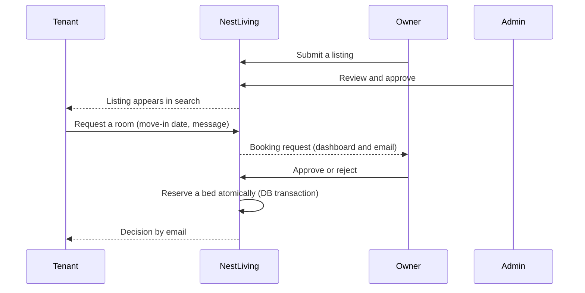

<div align="center">

# // NestLiving

### Find the room. Find the right roommate. No brokers.

A shared-living marketplace for India that brings **admin-reviewed listings**, **lifestyle-based roommate matching** and **transparent booking requests** into one place.

[Live demo](https://nestliving-ten.vercel.app/) · [Report a bug](../../issues) · [Request a feature](../../issues)


</div>

---

## Table of contents

- [Why NestLiving](#why-nestliving)
- [Features](#features)
- [How it works](#how-it-works)
- [What makes it well built](#what-makes-it-well-built)
- [Tech stack](#tech-stack)
- [Getting started](#getting-started)
- [Environment variables](#environment-variables)
- [Deployment](#deployment)
- [Project structure](#project-structure)
- [Roadmap](#roadmap)
- [Contributing](#contributing)
- [Author](#author)

---

## Why NestLiving

Finding shared accommodation is stressful, and the usual options are bad ones:

| The problem | How NestLiving answers it |
|---|---|
| Brokers charge a fee and the listings are unclear | Owners list directly, and **every listing is reviewed by an admin** before it goes live |
| Fake or stale listings | Only approved properties with real availability appear in search |
| Moving in with a stranger whose habits clash with yours | A **0 to 100 compatibility score** based on cleanliness, noise, sleep schedule, smoking and pets |
| Not knowing whether an owner has even seen your request | Every request has a **clear status** (pending, approved or rejected) and both sides get email updates |
| Two people chasing the last bed | Booking approval is **race-safe**, so a bed can never be given away twice |
| Worry about personal data | Government IDs are **encrypted at rest**, and passwords are hashed |

**Built for** students and young professionals looking for rooms, and for PG and flat owners who want serious, verified tenants.

---

## Features

### For tenants
- Browse and search rooms with filters for location, budget, room type, gender preference and amenities, sorted by price or newest
- Send a booking request with a move-in date and a message, and track its status from your dashboard
- Create a lifestyle profile and get **ranked roommate recommendations** with a compatibility percentage
- Send roommate connection requests
- Upload a profile photo, and control which emails you receive

### For owners
- Owner onboarding with business details and government ID (stored encrypted)
- Create listings with photos, rooms, bed counts, rent, deposit and availability date
- Dashboard with occupancy rate, pending applications and booked rent
- Review each tenant request and **approve or reject** it in one click

### For admins
- Review queue for new property listings (approve or reject)

### Platform
- Email verification and password reset
- Reliable transactional email with automatic retries
- Role-based access (Tenant, Owner, Admin) enforced on the server
- Responsive, mobile-friendly interface

---

## How it works



---

## What makes it well built

- **Race-safe bookings.** Approval runs inside a database transaction that decrements `availableBeds` only while it is above zero. Two owners or two clicks can never claim the last bed. A unique `(tenant, room)` constraint also prevents duplicate requests.
- **Reliable email (outbox pattern).** Emails are written to a queue first, with bodies **encrypted with AES-256-GCM**, then sent with retries and backoff. A failed SMTP call never loses a message or breaks the user's request.
- **Privacy by design.** Government IDs are encrypted at rest, and passwords use bcrypt. Registration answers the same way whether or not an email already exists, so it does not leak who has an account.
- **Abuse protection.** Rate limiting is stored in the database, so it works across serverless instances.
- **Server-side authorization.** Roles are checked in middleware and again in every protected page and API route, not just in the UI.
- **Validated everywhere.** Zod schemas guard every API boundary and form.
- **Search that scales.** Cursor pagination and compound indexes on the fields people filter by.
- **Deterministic matching.** The compatibility engine is a pure, testable function with no hidden state.

---

## Tech stack

| Layer | Technology |
|---|---|
| Framework | Next.js 14 (App Router), React, TypeScript (strict) |
| Styling | Tailwind CSS, lucide-react icons |
| Database | MongoDB Atlas with Prisma ORM |
| Auth | `jose` JWT in httpOnly cookies, `bcryptjs` |
| Validation | Zod |
| Email | Nodemailer (SMTP) or Resend |
| Images | Cloudinary (signed uploads) |
| Hosting | Vercel |

---

## Getting started

**Prerequisites:** Node.js 18.17 or newer, and a MongoDB Atlas cluster (a free tier is enough). Transactions require a replica set, which Atlas provides by default.

```bash
# 1. Clone and install
git clone https://github.com/thethinkingstack13-eng/nestliving.git
cd nestliving
npm install

# 2. Configure environment variables
cp .env.example .env        # then fill in the values (see the table below)

# 3. Create the database collections and indexes
npx prisma generate
npx prisma db push

# 4. (Optional) create the first admin account
ADMIN_EMAIL="you@example.com" ADMIN_PASSWORD="a-long-random-passphrase" npx prisma db seed

# 5. Run the app
npm run dev                 # http://localhost:3214
```

Useful scripts: `npm run dev`, `npm run build`, `npm run start`.

---

## Environment variables

| Variable | Required | Description |
|---|---|---|
| `DATABASE_URL` | Yes | MongoDB Atlas connection string |
| `JWT_SECRET` | Yes | 32+ random characters (`openssl rand -base64 48`) |
| `EMAIL_OUTBOX_ENCRYPTION_KEY` | Yes | 64 hex characters (`openssl rand -hex 32`) |
| `OWNER_ID_ENCRYPTION_KEY` | Yes | 64 hex characters, **different** from the one above |
| `CRON_SECRET` | Yes | Secret protecting the email-retry endpoint |
| `APP_URL` | Yes (production) | Public site URL, for example `https://your-app.vercel.app`, without a trailing slash |
| `SMTP_HOST`, `SMTP_PORT`, `SMTP_USER`, `SMTP_PASS`, `EMAIL_FROM` | One email option | SMTP credentials (Gmail app password, Brevo and similar) |
| `RESEND_API_KEY` | One email option | Alternative to SMTP |
| `CLOUDINARY_CLOUD_NAME`, `CLOUDINARY_API_KEY`, `CLOUDINARY_API_SECRET` | For uploads | Image storage |
| `ADMIN_EMAIL`, `ADMIN_PASSWORD` | Seeding only | Used by `prisma db seed`. Do **not** set these on the hosting platform. |

> Never commit `.env`. Only `.env.example` belongs in the repository.

---

## Deployment

1. Push the repo to GitHub and import it in **Vercel** (framework preset: Next.js, leave the build command at its default).
2. Add all environment variables above. Mark secrets as **Sensitive**.
3. Deploy once, then set `APP_URL` to the live URL and **redeploy**.
4. In MongoDB Atlas, allow network access from Vercel (Network Access).
5. Seed the admin account from your own machine against the production database.
6. For best latency, keep the Vercel function region and the Atlas cluster region close to each other.

---

## Project structure

```
app/
  api/            Route handlers (auth, bookings, rooms, roommates, uploads, cron)
  auth/           Login, register, verify email, password reset
  dashboard/      Tenant, owner and admin dashboards
  onboarding/     Tenant and owner onboarding flows
  rooms/          Room search
  roommates/      Roommate discovery
  profile/        Profile page
  settings/       Account, password and notification settings
components/       Reusable UI (Navbar, cards, tables, forms)
lib/              Auth, sessions, validation, compatibility engine, email, rate limiting
prisma/           Schema and seed script
middleware.ts     Route protection and role checks
```

---

## Roadmap

- [ ] In-app notifications, and contact details shared once a request is accepted
- [ ] Full profile editing with photo and phone verification (OTP)
- [ ] Room detail pages with photo gallery
- [ ] Cancel or withdraw a booking request
- [ ] Saved rooms and alerts for new matching listings
- [ ] Reviews, plus report and block tools
- [ ] Installable PWA with push notifications

---

## Contributing

Contributions are welcome.

1. Fork the repo and create a branch: `git checkout -b feature/your-feature`
2. Commit your changes: `git commit -m "Add your feature"`
3. Push and open a Pull Request

Please keep changes focused and describe what you tested.

---

## Author

**Designed and developed by [Avik Gupta](https://github.com/Avik-Idealprogrammer).**

If you find NestLiving useful, consider giving it a star.